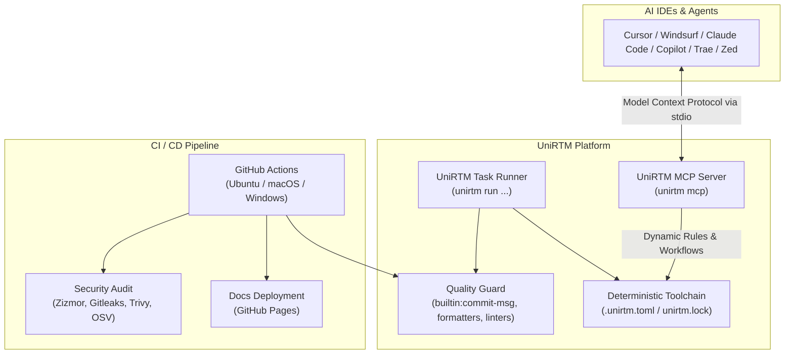

# Snowdream Tech AI IDE Template

[](https://github.com/snowdreamtech/template/actions/workflows/ci.yml)
[](https://github.com/snowdreamtech/template/actions/workflows/cd.yml)
[](https://github.com/snowdreamtech/template/actions/workflows/pages.yml)
[](https://github.com/snowdreamtech/template/actions/workflows/codeql.yml)
[](https://github.com/snowdreamtech/template/actions/workflows/ci.yml)
[](https://github.com/snowdreamtech/template/actions/workflows/ci.yml)
[](https://github.com/snowdreamtech/UniRTM)
[](https://github.com/snowdreamtech/template/releases/latest)
[](https://opensource.org/license/MIT)
[](https://github.com/snowdreamtech/template/releases/latest)
[](https://github.com/snowdreamtech/template/blob/main/.github/dependabot.yml)
[](https://github.com/snowdreamtech/template)
[](https://github.com/snowdreamtech/template/issues)
[](https://github.com/snowdreamtech/template)

[English](README.md) | [简体中文](README_zh-CN.md)

An enterprise-grade, foundational template designed for multi-AI IDE collaboration, powered by [UniRTM](https://github.com/snowdreamtech/UniRTM). This repository employs a **Zero-Footprint Architecture** for AI agents, providing standard Model Context Protocol (MCP) services, deterministic toolchains, and multi-level quality guardrails across Linux, macOS, and Windows.

---

## 🌟 Key Features

- **Zero-Footprint AI Integration**: Connects any AI IDE or agent (Cursor, Windsurf, Claude Code, GitHub Copilot, Roo Code, Trae, Zed) via standard Model Context Protocol (`unirtm mcp`) without polluting the repository with 50+ proprietary dot-directories (`.cursor/`, `.cline/`, etc.).
- **UniRTM Deterministic Toolchain**: Pins and cryptographically verifies all compiler runtimes (Node.js, Go, Python) and development tools across platforms via `unirtm.lock`.
- **Native Quality Guardrails**: Built-in Conventional Commits validation (`builtin:commit-msg`), code formatting, and linting rules enforced locally and remotely with zero external overhead.
- **Enterprise-Grade Security Pipeline**: Deep secret scanning via Gitleaks, GitHub Actions security scanning with Zizmor, and multi-layer dependency vulnerability scanning via OSV-Scanner and Trivy.
- **Reproducible DevContainers**: Standardized `.devcontainer` configuration ensuring 100% development parity between cloud IDEs and local workstations.
- **Bilingual Documentation Site**: Modern VitePress documentation automatically built and deployed to GitHub Pages.

---

## 🏗️ Architecture



### Core Architecture Pillars

1. **Zero Repository Pollution**: AI agent instructions, rules, and workflows are provided dynamically over stdio MCP (`unirtm://config`, `unirtm://conventions`) rather than static configuration files committed to the repository root.
2. **Single Source of Truth (SSoT)**: All project dependencies, task workflows, and quality policies are centrally declared in [.unirtm.toml](.unirtm.toml) and pinned in [unirtm.lock](unirtm.lock).
3. **Triple Guarantee Quality Gate**: Clean code quality is enforced at three checkpoints: IDE real-time formatting, local Git pre-commit hooks, and multi-OS GitHub Actions CI matrix.

---

## 📖 Quick Start

### Prerequisites

- **[UniRTM](https://github.com/snowdreamtech/UniRTM) (>= 0.39.0)**: Global universal runtime and task manager.
- **Git**: Configured with user email and signing key (recommended).

### Bootstrap Workflow

```bash
# 1. Clone repository
git clone https://github.com/snowdreamtech/template.git
cd template

# 2. Trust the repository configuration
unirtm trust

# 3. Setup toolchains and install local hooks
unirtm run setup

# 4. Verify environment and execute full workspace quality check
unirtm run verify
```

---

## 🛠️ Task Reference

All workflows are standardized through UniRTM tasks defined in [.unirtm.toml](.unirtm.toml):

| Command | Purpose | Description |
| :--- | :--- | :--- |
| `unirtm run setup` | Toolchain Bootstrap | Installs pinned compilers, tools, and hooks |
| `unirtm run verify` | Full Quality Check | Runs all formatters, linters, and security scanners |
| `unirtm run audit` | Security Audit | Runs Gitleaks, Zizmor, Trivy, and OSV-Scanner |
| `unirtm run fix` | Auto-Fix Issues | Automatically corrects formatting and fixable lint errors |
| `unirtm run docs:dev` | Local Docs Server | Starts VitePress documentation server with hot reload |
| `unirtm run docs:build` | Build Docs | Builds production-ready static documentation |
| `unirtm mcp` | AI Agent Server | Starts standard Model Context Protocol server |

---

## 📂 Project Structure

```text
project-root/
├── .devcontainer/        # 🐳 Standardized reproducible DevContainer environment
├── .github/              # 🐙 GitHub integration and automation
│   └── workflows/        # 🚀 Multi-OS verified CI/CD workflows (CI, CD, Pages, CodeQL)
├── .vscode/              # 💻 Recommended editor configurations and task definitions
├── docs/                 # 📖 VitePress comprehensive bilingual documentation site
│   ├── guide/            # Architectural principles, CI, and pre-commit guides
│   ├── reference/        # Configuration, toolchain, and API specifications
│   ├── security/         # Supply chain security analysis and mitigation
│   └── workflows/        # SpecKit workflow documentation
├── schemas/              # 📐 JSON schemas for UniRTM toolchain and manifests
├── .editorconfig         # 📝 Cross-editor formatting specifications
├── .unirtm.toml          # 🔧 Repository toolchain, guard rules, and task definitions
├── unirtm.lock           # 🔒 Cryptographically pinned tool versions and cross-platform hashes
├── CHANGELOG.md          # 📜 Release history (automated via Release-Please)
├── CONTRIBUTING.md       # 🤝 Contributor guidelines and standards
├── LICENSE               # ⚖️ MIT License
└── VERSION               # 🏷️ Semantic project version
```

---

## 🔒 Security Model

- **Secret Detection**: Hardcoded credential protection enforced via Gitleaks on staged files and historical commits.
- **Actions Hardening**: Workflow permissions and syntax audited via Zizmor and Actionlint.
- **Dependency Auditing**: Automated dependency vulnerability scanning with OSV-Scanner and Trivy.
- **Reproducible Builds**: All downloaded tools and artifacts are verified against cryptographic SHA-256 checksums in `unirtm.lock`.

---

## ❓ Troubleshooting

- **Configuration not trusted warning**:
  - *Diagnosis*: `Tasks in .unirtm.toml are ignored because the configuration file is not trusted`.
  - *Solution*: Run `unirtm trust` in the workspace root.
- **Windows PowerShell Execution Policy**:
  - *Diagnosis*: `unirtm run ...` blocked by script execution policies on Windows.
  - *Solution*: Run `Set-ExecutionPolicy -Scope Process -ExecutionPolicy Bypass` in your terminal.
- **Gitleaks false positives**:
  - *Diagnosis*: Gitleaks flags non-sensitive test tokens or mocks.
  - *Solution*: Add the specific commit hash or rule fingerprint to [.gitleaksignore](.gitleaksignore).
- **Missing platforms during lock generation**:
  - *Diagnosis*: `unirtm lock` reports missing target platform assets.
  - *Solution*: Run `unirtm lock --allow-incomplete` to maintain pinned binaries for supported platforms.

---

## 📄 License

This project is licensed under the **MIT License**.
Copyright (c) 2026-present [SnowdreamTech Inc.](https://github.com/snowdreamtech)
See the [LICENSE](./LICENSE) file for details.

## 🌟 Star History

[](https://www.star-history.com/?repos=snowdreamtech%2Ftemplate&type=date&legend=top-left)
