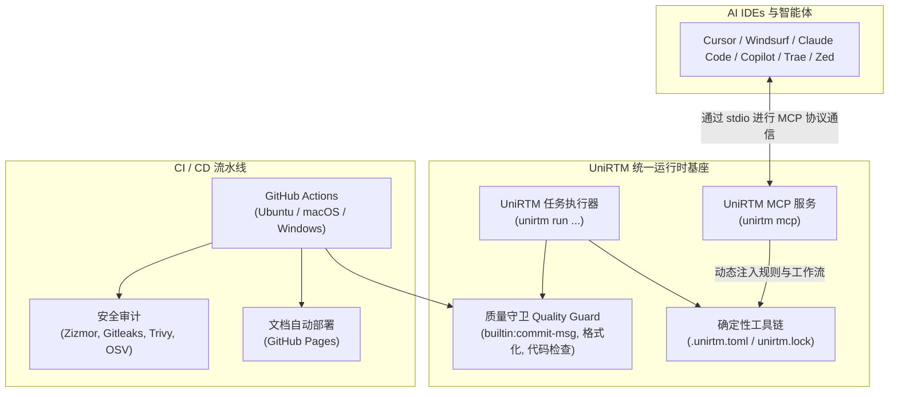

# Snowdream Tech AI IDE 模板

[](https://github.com/snowdreamtech/template/actions/workflows/ci.yml)
[](https://github.com/snowdreamtech/template/actions/workflows/cd.yml)
[](https://github.com/snowdreamtech/template/actions/workflows/pages.yml)
[](https://github.com/snowdreamtech/template/actions/workflows/codeql.yml)
[](https://github.com/snowdreamtech/template/actions/workflows/ci.yml)
[](https://github.com/snowdreamtech/template/actions/workflows/ci.yml)
[](https://github.com/snowdreamtech/UniRTM)
[](https://github.com/snowdreamtech/template/releases/latest)
[](https://opensource.org/license/MIT)
[](https://github.com/snowdreamtech/template/releases/latest)
[](https://github.com/snowdreamtech/template/blob/main/.github/dependabot.yml)
[](https://github.com/snowdreamtech/template)
[](https://github.com/snowdreamtech/template/issues)
[](https://github.com/snowdreamtech/template)

[English](README.md) | [简体中文](README_zh-CN.md)

基于 [UniRTM](https://github.com/snowdreamtech/UniRTM) 构建的企业级多 AI IDE 协作脚手架。本项目采用针对 AI 智能体的**零侵入架构 (Zero-Footprint Architecture)**，提供标准 Model Context Protocol (MCP) 服务、确定性锁版本工具链以及覆盖 Linux、macOS 和 Windows 的全链路工程质量守卫。

---

## 🌟 核心特性

- **零侵入 AI 集成 (Zero-Footprint)**：通过标准 Model Context Protocol (`unirtm mcp`) 对接任意 AI IDE 或智能体（Cursor、Windsurf、Claude Code、GitHub Copilot、Roo Code、Trae、Zed 等），无需在仓库根目录提交 50+ 个私有配置目录（如 `.cursor/`、`.cline/` 等）。
- **UniRTM 确定性工具链**：通过 [unirtm.lock](unirtm.lock) 锁定各编译器运行时（Node.js、Go、Python）及所有开发工具的精准版本与 SHA-256 跨平台完整性哈希。
- **原生质量守卫 (Quality Guard)**：内置开箱即用的约定式提交验证（`builtin:commit-msg`）、代码格式化与代码检查，本地毫秒级校验，彻底摆脱重型外部运行时包装。
- **企业级安全防线**：基于 Gitleaks 的提交级硬编码机密扫描、基于 Zizmor 的 GitHub Actions 工作流安全审计，以及基于 OSV-Scanner 与 Trivy 的多层依赖漏洞检测。
- **可复现 DevContainer**：标准化的 `.devcontainer` 环境，实现本地开发机与云端开发容器的 100% 环境一致性。
- **双语文档站点**：现代化的 VitePress 文档架构，自动化构建并持续部署至 GitHub Pages。

---

## 🏗️ 架构设计



### 核心架构原则

1. **零仓库污染 (Zero Pollution)**：AI 智能体的提示词规则与工作流通过 stdio MCP 动态提供（`unirtm://config`、`unirtm://conventions`），严禁在项目根目录产生工具碎片。
2. **单一事实来源 (SSoT)**：所有开发工具链、任务流水线与代码质量契约集中在 [.unirtm.toml](.unirtm.toml) 中声明，并在 [unirtm.lock](unirtm.lock) 中固化版本与哈希。
3. **三重质量护城河**：由 IDE 本地格式化、Git Pre-commit 守卫阻断与多平台 GitHub Actions CI 构筑坚实的代码纯净度防线。

---

## 📖 快速开始

### 前置要求

- **[UniRTM](https://github.com/snowdreamtech/UniRTM) (>= 0.39.0)**：全局统一运行时与任务管理工具。
- **Git**：建议配置好提交用户邮箱与 GPG 签名密钥。

### 引导流程

```bash
# 1. 克隆仓库
git clone https://github.com/snowdreamtech/template.git
cd template

# 2. 信任仓库配置
unirtm trust

# 3. 安装工具链并配置本地 Git 钩子
unirtm run setup

# 4. 验证环境并执行全工作区质量验证
unirtm run verify
```

---

## 🛠️ 任务清单参考

所有常规工作流均通过 [.unirtm.toml](.unirtm.toml) 中的 UniRTM 任务标准化定义：

| 命令 | 用途 | 说明 |
| :--- | :--- | :--- |
| `unirtm run setup` | 工具链引导 | 安装锁定版本的编译器、工具并配置钩子 |
| `unirtm run verify` | 全量质量检查 | 执行所有代码格式化、Linter 及安全规则校验 |
| `unirtm run audit` | 安全漏洞审计 | 运行 Gitleaks、Zizmor、Trivy 及 OSV-Scanner |
| `unirtm run fix` | 自动修复 | 自动修正支持的代码格式与可修复语法规则 |
| `unirtm run docs:dev` | 本地文档服务 | 启动 VitePress 实时热更新文档开发服务器 |
| `unirtm run docs:build` | 编译文档 | 编译用于生产部署的静态文档站点 |
| `unirtm mcp` | AI 智能体服务 | 启动标准 Model Context Protocol 服务端 |

---

## 📂 项目结构

```text
project-root/
├── .devcontainer/        # 🐳 标准化可复现 DevContainer 开发容器配置
├── .github/              # 🐙 GitHub 集成与自动化流水线
│   └── workflows/        # 🚀 经多系统验证的 Actions 工作流 (CI, CD, Pages, CodeQL)
├── .vscode/              # 💻 推荐的编辑器设置与任务定义
├── docs/                 # 📖 VitePress 完整中英双语文档站点
│   ├── guide/            # 架构理念、CI/CD 与预提交钩子说明
│   ├── reference/        # 配置手册、工具链参考与规范
│   ├── security/         # 供应链安全分析与防护指南
│   └── workflows/        # 规范化工作流文档
├── schemas/              # 📐 UniRTM 工具链与清单的 JSON Schema 定义
├── .editorconfig         # 📝 跨编辑器基础格式化规范
├── .unirtm.toml          # 🔧 仓库工具链、质量守卫规则与任务定义
├── unirtm.lock           # 🔒 精确固化的工具版本与跨平台 SHA-256 完整性哈希
├── CHANGELOG.md          # 📜 版本变更历史（基于 Release-Please 自动生成）
├── CONTRIBUTING.md       # 🤝 贡献者指南与社区规范
├── LICENSE               # ⚖️ MIT 开源许可证
└── VERSION               # 🏷️ 语义化版本声明文件
```

---

## 🔒 安全保障机制

- **机密防护**：在暂存区与历史提交上严格执行 Gitleaks 密钥检测，防止凭据泄露。
- **流水线加固**：通过 Zizmor 与 Actionlint 审计 Actions 最小权限与语法安全。
- **依赖审计**：通过 Google OSV-Scanner 与 Aqua Trivy 双重扫描第三方依赖安全隐患。
- **可复现构建**：所有外部二进制与工具均与 `unirtm.lock` 中的 SHA-256 哈希进行密码学强校验。

---

## ❓ 常见问题排查

- **配置未信任警告**：
  - *现象*：`Tasks in .unirtm.toml are ignored because the configuration file is not trusted`。
  - *解决*：在项目根目录下执行 `unirtm trust` 即可。
- **Windows PowerShell 脚本执行策略受限**：
  - *现象*：Windows 终端下运行任务时报错提示脚本执行策略限制。
  - *解决*：在终端运行 `Set-ExecutionPolicy -Scope Process -ExecutionPolicy Bypass`。
- **Gitleaks 误报测试用例数据**：
  - *现象*：测试文件中的 Mock 数据或特定格式字符串被识别为泄露。
  - *解决*：将指纹或规则添加到 [.gitleaksignore](.gitleaksignore) 或在 [.gitleaks.toml](.gitleaks.toml) 中配置白名单。
- **生成锁文件时报告平台不完整**：
  - *现象*：某些特定架构上游未发布官方二进制，执行 `unirtm lock` 出现缺失提示。
  - *解决*：使用 `unirtm lock --allow-incomplete` 命令完成对已有支持平台的精准锁定。

---

## 📄 许可证

本项目采用 **MIT 许可证** 授权。
版权所有 (c) 2026-现在 [SnowdreamTech Inc.](https://github.com/snowdreamtech)
详见 [LICENSE](./LICENSE) 文件。

## 🌟 Star History

[](https://www.star-history.com/?repos=snowdreamtech%2Ftemplate&type=date&legend=top-left)
